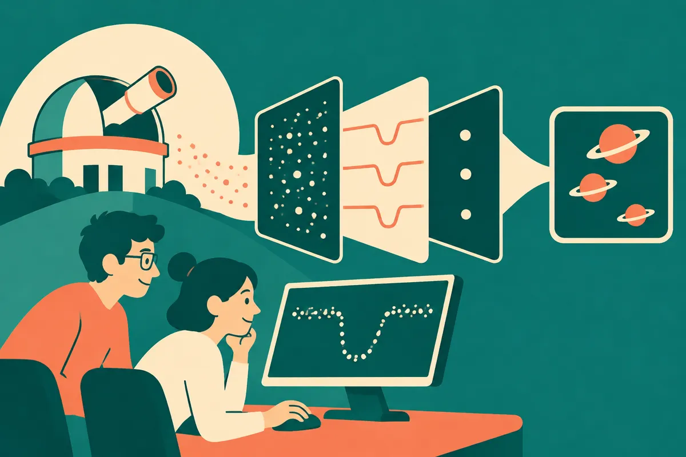

TL;DR: The useful takeaway from OpenAI’s Astra exoplanet story is not “AI found planets,” it is that coding agents can help motivated non-specialists turn public scientific archives into working analysis pipelines.

## What did OpenAI actually claim?

OpenAI’s blog post, “Searching for distant planets with Astra,” says two amateur astronomers used Codex and Astra to find potential exoplanets in public data from NASA’s Kepler and TESS space telescopes.

That wording matters. Potential exoplanets. Public data. Amateur astronomers. Codex and Astra as tools in the workflow, not as magic discovery machines.

The interesting part is the shape of the work. Kepler and TESS produce light curves, which are brightness measurements over time. If a planet crosses in front of a star from our point of view, the star can dim in a regular pattern. That pattern is small, messy, and easy to confuse with other things. Instrument artifacts, binary stars, stellar variability, and plain bad assumptions can all look like something exciting if you squint.

So the real job is not “ask an AI to find planets.” It is cleaning data, writing scripts, testing candidate filters, visualizing signals, rerunning checks, and keeping yourself honest when the output looks cool. That is exactly the kind of grind where coding assistants can help.

Codex can turn intent into code faster. Astra, as described by OpenAI in this story, sits in the discovery workflow around the search itself. The win is not that the user stops thinking. The win is that the user can iterate more often before running out of patience.

## Why does this matter beyond astronomy?

This is a good example of AI making the long tail of technical work less brittle.

A lot of useful science and data work lives in an awkward middle. The data is public. The methods are knowable. The tools exist. But the activation energy is high. You need enough Python, enough domain context, enough statistics, enough file-format patience, and enough stubbornness to keep going when the first notebook fails.

That is where AI assistants are genuinely useful. Not as authorities, but as accelerators for people who already have a question and are willing to check the answer.

The same pattern applies outside exoplanets. Local governments publishing messy datasets. Small labs rechecking public biomedical repositories. Journalists analyzing procurement records. Operators looking at logs, search data, customer feedback, or conversion paths. The common thread is not glamour. It is workflow compression.

The important distinction: AI lowers the cost of trying. It does not lower the standard for proof.

In science, a candidate is not a confirmed result. In business, a pattern is not causality. In SEO, a rank movement is not automatically explained by the last thing you changed. In security, an anomaly is not always an attack. AI can help surface leads, but the burden of validation does not move.

## Where does the hype creep in?

The phrase “AI discovers planets” will always be tempting. It is also usually the least useful framing.

Discovery is a chain. Someone chooses the data. Someone defines the search. Someone writes or accepts the filtering logic. Someone decides which candidates are worth attention. Someone checks for false positives. Someone submits the work to a community that can tear it apart.

AI can participate in that chain. It can speed up pieces of it. It can also introduce quiet errors, especially when users treat plausible code or plausible explanations as finished work.

That is why this OpenAI example is strongest when read as a story about augmented amateur research, not autonomous science. The tools helped two people work with serious public datasets. That is meaningful. It is also bounded.

My practical read: if you are building with AI, copy the workflow, not the headline. Pick a public or internal dataset you already understand. Use a coding agent to build the boring pipeline: fetch, clean, transform, visualize, flag candidates, rerun checks. Then add a separate verification step that does not depend on the same prompt or the same assumptions. The catch most readers miss is that the best AI workflows still need a human-owned definition of “good evidence.”
