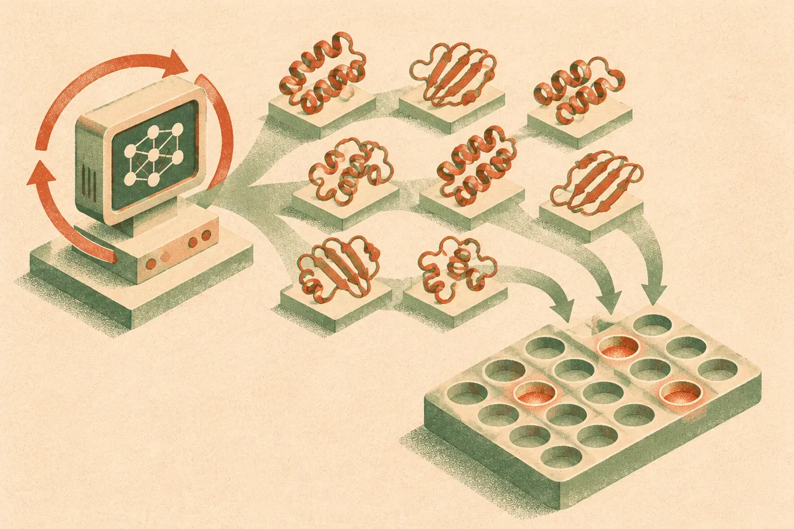

TL;DR: OpenAI’s GPT-6 protein-design result is most interesting as evidence that a general reasoning model can help propose testable biology, but the lab validation details matter more than the headline.

## What did OpenAI actually claim?

The primary source here is OpenAI’s blog post, “GPT-6 models demonstrate intrinsic protein-design capabilities.” OpenAI reported that GPT-6 models can design protein structures and sequences using reasoning and code. It also said lab tests found evidence of binding across five targets.

That is a meaningful claim, but it is a narrow one.

“Evidence of binding” is not the same thing as a ready drug, a validated therapeutic, or a solved protein-design pipeline. Binding is an early signal. Useful, sometimes exciting, but still one stop in a longer chain that includes specificity, affinity, stability, manufacturability, toxicity, delivery, and repeatability across assays.

The phrase that caught my attention is not “protein-design capabilities.” It is “using reasoning and code.” That frames GPT-6 less like a specialized biology model and more like a general problem-solving system that can reason through constraints, write or use computational tools, and produce biological candidates that can be tested in the real world.

That is the bigger shift if it holds up.

A protein-design model that only works inside a narrow training setup is useful. A general reasoning model that can move between structure, sequence, constraints, scripts, analysis, and lab feedback is a different kind of tool. It starts to look like a research operator.

## Why does reasoning matter in protein design?

Protein design is not just “generate a sequence.” It is a search problem with ugly constraints. Structure matters. Function matters. The physical world gets a vote. A candidate can look good computationally and still fail when tested.

Reasoning models may help because they can chain steps. They can form hypotheses, call tools, inspect outputs, revise plans, and explain why a candidate might satisfy a design goal. Code matters because a lot of science work already lives in scripts, notebooks, simulators, scoring functions, and data pipelines.

This is where the result becomes operationally interesting. If GPT-6 is not merely memorizing known protein patterns, but can use reasoning and code to propose new structures and sequences that show binding in lab tests, then the interface between model and lab changes.

The model is no longer just a generator. It becomes part of the experimental loop.

Still, the gap between “model proposed candidates” and “model is a reliable protein designer” is large. The OpenAI summary supplied here does not include target identities, assay types, hit rates, baselines, negative controls, affinity measurements, or comparisons against specialist protein-design systems. Those details decide how strong the claim really is.

Without them, I would treat this as a promising signal, not a settled benchmark.

## What should builders take from this?

For AI builders outside biology, the lesson is not “go build a drug company with GPT-6.” The lesson is that frontier models keep moving from text generation toward tool-mediated work in domains where reality checks are expensive.

That pattern shows up everywhere: code, robotics, materials, finance ops, security, and science. The winning workflows will not be chatbots that sound smart. They will be loops that connect model reasoning to tools, tests, and feedback.

In biology, the feedback is a lab assay. In software, it is tests and production telemetry. In marketing, it is rankings, conversions, and customer behavior. In operations, it is whether the process actually completes without breaking policy or budget.

OpenAI’s protein-design claim points at a practical architecture: model proposes, tools score, humans review, experiments test, results feed the next round. The magic is not one perfect prompt. It is the loop.

Practitioner’s take: if you are building with reasoning models, copy the structure, not the domain. Pick a task where outputs can be tested, wire the model to the scoring tools it needs, keep a human in the review path, and log failures aggressively. The catch most readers miss: the value is not that the model “knows science.” The value is whether it can produce candidates that survive contact with a real test.
