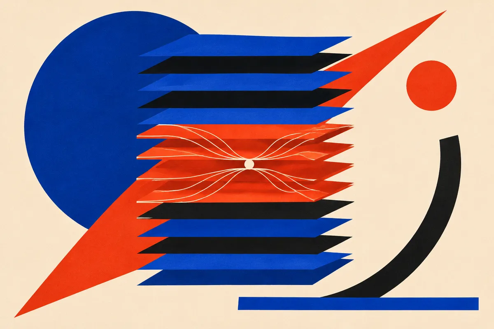

TL;DR: A 421M-parameter encoder called Laya was caught picking answer options by their name instead of their description, and the authors of "Deneb-Vritra" localized that shortcut to a four-layer attention window and switched it off without wrecking accuracy, which is a cleaner interpretability result than most because they wrote their predictions down first and watched most of them fail.

The paper is "Deneb-Vritra: Descriptions, Edges and Names Examined by Blocking Via Restoring Token Representations and Attention," posted to arXiv under both cs.AI and cs.CL. It is a small, honest piece of mechanistic interpretability, and it earns a flagship slot not because the model is important but because the method is the kind of thing builders should steal.

## What is the shortcut, and why does it matter?

Laya is an encoder that reads a text and a question in a single forward pass. Each answer option is written as a name plus a description, and each option gets a marker token. The network reads one score off each marker. Clean setup, the kind you see in retrieval and classification systems that score candidates in parallel.

Here is the failure. The authors swap the names across options, so the name now sits on top of the wrong description. A model that actually reads the description should ignore the mismatched name and pick on meaning. Laya does not. It follows the name.

They measured how often. The released checkpoint picks the option with the right name 53% of the time after the swap. Their own fine-tune, called v1, is worse at 59%. A fine-tune trained with name randomisation drops to 11%. So the shortcut is real, it is strong, and it gets stronger when you fine-tune naively and weaker when you deliberately scramble names during training.

This is the quiet bug in a lot of scoring systems. You build an eval, the numbers look good, and the model is secretly matching on a surface feature that correlates with the right answer in your training distribution. Swap the surface feature and the whole thing falls over. The value of this paper is that it does not stop at "the model cheats." It asks where.

## Where in the network does the model take the shortcut?

This is the part worth reading closely. On a 320-item sample, they block attention from each marker token to its own name tokens, but only in layers 14 to 17 of 28. That single intervention cuts v1's name shortcut from 67% down to 16%. On two schemas they held out from component selection, it still lands at 19%, so it is not overfit to the exact data they tuned on. And accuracy on the original, unswapped names stays at 90%. They removed the cheat and kept the skill.

Contrast that with the interventions that did nothing. Blocking the marker's edges to the question, to other options, or to the text itself had no effect on the shortcut. So the name read is specifically the marker-to-name attention in that narrow layer window, not some diffuse property of the whole network.

No single attention head carries it. The largest single-head effect was 9 points. That matters because a lot of interpretability work goes hunting for the one magic head, and here the answer is that the behavior is distributed across the window. Attention mass tracks the window by layer but not by head. The mechanism is "these four layers, collectively," not "head 14.3."

They also confirmed it with activation patching. Restoring clean marker states undoes the name swap starting from layer 16. The name is actually decodable from the marker from layer 0 onward, which tells you the information is present early and the network's decision to act on it crystallizes in that mid-stack window.

## Why should you trust this result more than the usual story?

Two things set this apart, and both are about discipline rather than cleverness.

First, they preregistered predictions and reported the failures. Of 12 predictions they could score, written before running the experiments, 9 failed. Read that again. The authors said out loud what they expected, then told you three quarters of it was wrong. That is the opposite of the usual interpretability paper, where a clean post-hoc narrative gets fitted to whatever the activations happened to show. When someone shows you their failed bets, the surviving claims get a lot more credible.

Second, they stress-tested across five checkpoints: released, fine-tuned, name-randomised, and a pair trained without two schemas. The knockout finds similar layers in all of them. And here is the subtle finding. In the name-randomised checkpoints, the model still reads the name, it just gets outvoted. Blocking the description edges in those models brings the shortcut back to 56-58%. So name randomisation does not delete the name-reading circuit. It trains a competing description-reading pathway that wins the vote. The cheat is still in there, suppressed rather than removed.

They are honest about the probe story too. A one-direction probe erasure changed nothing, but they note it was a weaker edit than a random one, so they do not oversell it. And the layer-copy experiments, grafting layers 0-13 or 14-27 from a name-randomised sibling into a fine-tune, recover 66% and 65% of the shortcut reduction for v1, but only 21% and 45% for another pair. The effect is real but not uniform, and they say so.

## What does an operator actually do with this?

The limits are stated plainly: synthetic data, LLM-labelled, one architecture, one small encoder. Do not generalize "layers 14 to 17" to your model. That number is specific to this network.

But the method transfers directly, and that is the takeaway. If you run any system that scores candidates by a name-plus-description format, retrieval rerankers, classification heads, option scorers, agent tool selectors, you can build the exact probe this paper used. Construct a counterfactual set where the surface feature (the name, the title, the ID) contradicts the meaning. Measure how often your model follows the surface feature. That single number tells you whether your eval has been lying to you.

Then, if you find a shortcut, the harder lesson here is that retraining does not necessarily delete it. The name-randomised checkpoints prove the cheat circuit survives suppression. So "we fine-tuned it away" is not the same as "it is gone," and a distribution shift at inference time can let the old pathway outvote the new one again. The catch most readers will miss: the fix in this paper is an attention block at inference, a surgical intervention on a live model, not a training change. That is a different and more durable kind of control than hoping your fine-tune learned the right thing. If you can localize the shortcut, you can disable it at run time and keep the accuracy. That is the move worth copying.
