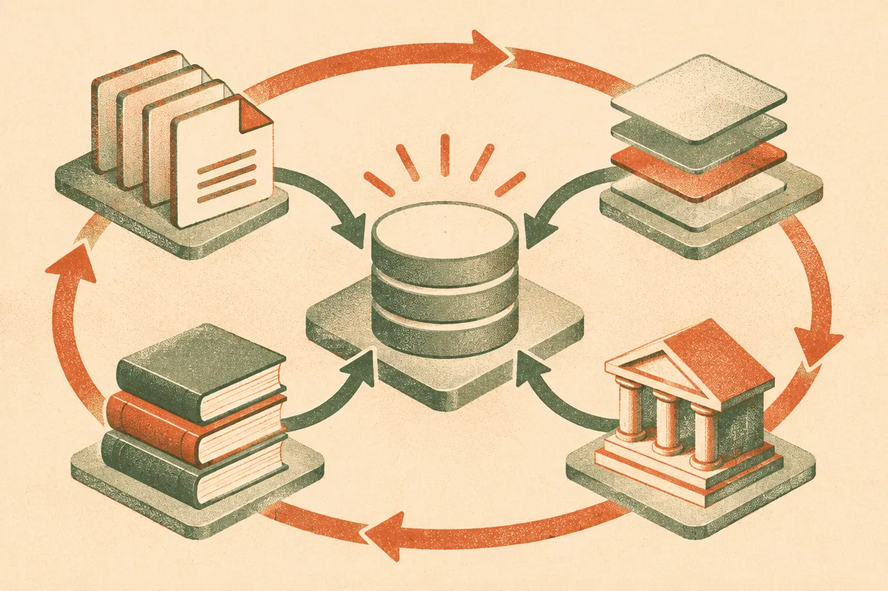

TL;DR: The useful legal AI pattern is not “ask a model a legal question,” it is building repeatable workflows that preserve business context across matters, counsel, and decisions.

## What does “connected intelligence” mean for legal teams?

OpenAI’s primary source here is its blog post, “Connected intelligence for in-house legal,” from OpenAI. The post points to a discussion with OpenAI’s Stacey Wang and Craig Bruney, Mary O’Carroll of LECG, and Cooley’s Richard Segal on how AI can help in-house legal teams connect business context, build reusable workflows, and get more from outside counsel.

That framing matters. Most legal AI demos still look like document tricks: summarize this contract, compare these clauses, draft this policy, extract obligations. Useful, yes. But in-house legal work is not just documents. It is decisions under company-specific risk tolerance.

A commercial team may want faster contract turnaround. Security may care about data handling. Finance may care about payment terms. Product may care about launch timing. Outside counsel may give a technically correct answer that misses the company’s actual operating posture.

The OpenAI framing suggests the better target: context that travels.

Not every matter should start from zero. If the legal team has already decided how it treats indemnity in a certain customer segment, or what fallback language is acceptable for a data processing addendum, or when to escalate a product claim to specialist counsel, that should become part of the operating system. Not just tribal memory. Not just a Slack thread. Not buried in last quarter’s contract redlines.

## Where should in-house legal teams start?

Start where the work repeats and the judgment is bounded.

Contract intake is the obvious first target. Not because it is glamorous, but because it has patterns. The requester wants an agreement reviewed. Legal needs deal context, customer type, risk level, deadlines, fallback positions, prior negotiation history, and escalation rules. AI can help collect and organize that context before a lawyer spends time on the matter.

The same applies to outside counsel management. OpenAI says the discussion covers getting more from outside counsel. The practical version is not “replace counsel.” It is making counsel less blind. Give them the company’s playbook, preferred risk posture, relevant prior decisions, and what the business is trying to achieve. Then capture what comes back in a reusable way.

That last part is usually the missing step.

A memo from outside counsel helps once. A memo turned into an internal decision tree helps repeatedly. Redlines from a partner help one deal. Redlines distilled into fallback language help the next 50. A model can help with that distillation, but only if the team designs the workflow around reuse.

This is where legal ops people should be central. Lawyers know the risk. Legal ops knows the process. AI without process just creates cleaner drafts of the same messy system.

## What can go wrong?

The failure mode is treating a model as a legal oracle.

In-house legal teams cannot outsource judgment to a generated answer. They need audit trails, matter context, access controls, privilege awareness, and clear review points. Some questions are safe for automation. Some are good candidates for assisted drafting. Some need a lawyer immediately. A useful system knows the difference, or at least forces the team to define it.

The other risk is context sprawl. If “connected intelligence” means every document, chat, and email gets dumped into a searchable pile, the team may create more risk than value. Legal knowledge needs boundaries. Drafts, privileged material, business-sensitive negotiations, and counsel advice should not be treated like generic enterprise content.

The right question is not “can AI answer this?” The better question is “what context should this workflow remember, who can see it, and when does a human decide?”

Practitioner’s take: pick one repeated legal workflow, such as NDA review, sales contract intake, or outside counsel memo reuse. Map the steps, define the required business context, write the escalation rules, and create a small library of approved outputs. Then test the AI on old matters where you already know the answer. The catch most teams miss: the model is not the system. The system is the workflow, permissions, review loop, and memory you build around it.
