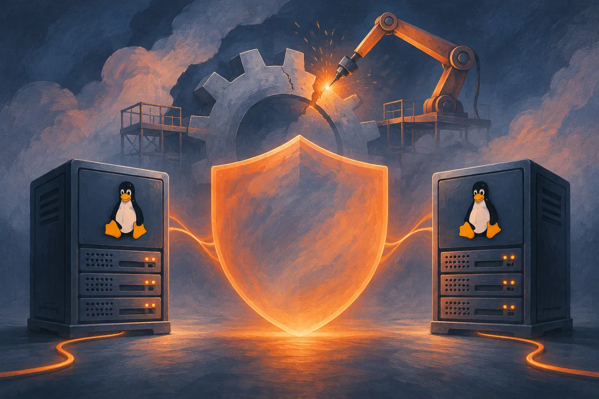

TL;DR: Shirudo is best understood as a temporary protection layer for Linux patch windows, useful if treated as testable mitigation rather than production-grade security magic.

## What is Shirudo actually for?

OpenAI and Cisco’s announcement, “OpenAI and Cisco introduce Shirudo,” describes Shirudo as an open-source runtime for Linux that helps teams protect running systems while they roll out patches.

That is a narrow, practical problem. Vulnerability disclosure does not line up neatly with maintenance windows. Patches need testing. Some systems cannot be restarted quickly. Some fleets have old dependencies, brittle services, or customer-facing uptime requirements. The dangerous period is not just “before a patch exists.” It is the messy middle, when everyone knows what needs to happen, but production has not caught up yet.

Shirudo appears aimed at that middle. The Defiant reported that the project lets teams test temporary exploit protections while preparing patches. That framing matters. A temporary exploit protection is not a fix. It is a seatbelt while the brakes are being repaired.

I like this category because it accepts reality. Operators do not patch instantly. Good security tooling should reduce risk during the delay, not pretend the delay does not exist.

## Why would OpenAI care about a Linux runtime?

The OpenAI angle is easy to overread. Based on the provided first-party claim, Shirudo is an open-source Linux runtime, not a new model, not an agent, and not an AI SOC in a box.

Still, the move fits a larger pattern. AI companies are no longer only model labs. They run large infrastructure. They sit inside enterprise procurement conversations. They need customers to believe their systems, dependencies, and deployment practices can survive contact with real production risk.

Cisco is the obvious partner for that world. Cisco sells into networks, infrastructure, and enterprise security. OpenAI brings brand gravity and a developer ecosystem. Together, they are pointing at a painful operational gap: known vulnerabilities plus slow patch adoption.

The interesting part is not “AI will defend Linux.” There is not enough in the supplied material to say that. The interesting part is OpenAI putting its name next to a low-level, open-source defensive runtime. That is much less glamorous than a chatbot demo, but much closer to the daily work of keeping systems alive.

## The production caveat is the story

The Defiant reported that Shirudo’s documentation says it is not yet production-ready. That should be printed in red on every internal evaluation plan.

Security teams love the idea of temporary mitigations. Attackers love brittle mitigations too. A runtime protection layer can fail open, fail closed, break workloads, hide symptoms, create false confidence, or become one more thing nobody fully owns. Open source helps with inspection and trust, but it does not magically solve operational burden.

The right question is not “does Shirudo replace patching?” It clearly should not. The better question is: can a team safely test a mitigation, understand its blast radius, and remove it after the real patch lands?

That removal step is where many shops stumble. Temporary controls become permanent furniture. Then nobody remembers why they exist, which workloads depend on them, or whether they still protect against the thing they were added for.

For builders and security operators, I would try Shirudo first in a lab that mirrors one boring production service, not the most critical system in the fleet. Pick a known vulnerability class, test whether temporary protection changes exploit behavior, watch for app breakage, and write the rollback plan before celebrating. The catch most readers miss: a mitigation tool only helps if your patch process, ownership model, and cleanup discipline are already real.
