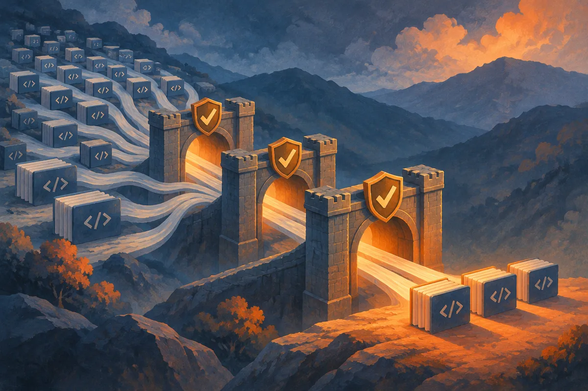

TL;DR: Coding agents get interesting when they move from helping one developer in one repo to operating across thousands of repos, where context, permissions, review, and ownership matter more than prompt quality.

## What does 15,000 repositories tell us?

OpenAI’s primary source here is its blog post, “How iFood scales coding agents across 15,000 repositories.” The number is the story.

A single repo demo is easy to understand. Ask an agent to fix a bug, write a test, update a dependency, or explain a function. The agent has bounded context. The blast radius is obvious. A human can inspect the diff and decide.

Fifteen thousand repositories is a different operating environment. That is not a coding task. That is organizational plumbing.

At that scale, the hard questions are not “Can the model write code?” They are “Which repo is authoritative?” “Who owns this service?” “What dependencies are safe to touch?” “Can an agent read production-adjacent code?” “What happens when the same migration pattern applies to 800 repos, but 60 of them have weird local history?”

This is where most coding-agent talk gets too shiny. The model is only one piece. The system around it matters more: repo indexing, permission boundaries, CI hooks, test coverage, review policy, audit trails, rollback paths, and a clear definition of what work the agent is allowed to attempt without creating noise.

OpenAI’s framing around iFood is useful because it points to scale as the forcing function. In a company with a sprawling codebase, the marginal value may come less from one spectacular pull request and more from boring, repeatable maintenance work. Dependency updates. Test generation. Code search. API migration prep. Small refactors. Documentation drift. The stuff humans should not have to rediscover 15,000 times.

## Where do coding agents actually break in the enterprise?

They break on context first.

Not context window size. Organizational context. A model can read files, but it does not automatically know which team owns a service, which old pattern is intentional, which test suite is flaky, or which “temporary” workaround is now load-bearing infrastructure.

They also break on trust. If every agent pull request needs a senior engineer to debug it from scratch, the agent is not saving time. It is creating a new ticket queue. The useful bar is not “the code compiles once.” The useful bar is “the proposed change is small, reviewable, explainable, scoped to the right repo, backed by tests, and easy to reject.”

That changes the product requirement. A coding agent in an enterprise should be less like a magic pair programmer and more like a disciplined junior engineer with access controls. It should state assumptions. It should show its search path. It should attach test results. It should know when to stop. It should produce diffs that fit the review culture already in place.

This is also why broad repo estates are both painful and attractive. They contain huge amounts of repeated work, but they also contain years of local exceptions. Agents can help find patterns across that mess. They can also confidently stamp the wrong pattern everywhere if the workflow is sloppy.

## What should builders copy from this pattern?

The move is not “turn on coding agents for the whole company.”

The move is to start with one class of work that is repetitive, measurable, and easy to review. Pick a task where success is visible in CI or static analysis. Give the agent a narrow lane. Put it behind existing permissions. Require small diffs. Track accepted PRs, rejected PRs, reviewer time, failure modes, and follow-up defects.

That sounds less exciting than an autonomous engineer. Good. It is also how these systems become useful.

The companies that win with coding agents will probably not be the ones with the flashiest prompts. They will be the ones that treat agents as part of the software delivery system: tied into code ownership, tests, review, observability, and security. The agent should not be a side chat window guessing at your architecture. It should be a controlled worker inside the same rails your engineers already use.

For a builder, I would try this on maintenance work before feature work. Choose 20 repos, not 15,000. Run the agent on one repeatable change. Measure how many diffs get merged without extra cleanup. The catch most readers miss: scaling coding agents is mostly not an AI rollout. It is a repo hygiene, developer-experience, and governance project with an AI worker attached.
