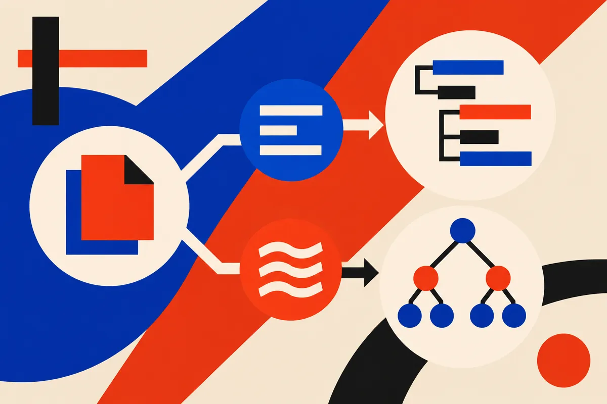

TL;DR: When you hand a coding agent a branching rule written by a domain expert, the dangerous failures are the ones that still run and return a plausible answer, and the only way to catch them is a benchmark that tests hidden cases at the decision level, not vibes at the demo level.

There is a whole class of software that nobody writes by hand anymore if they can help it. Screening logic. Eligibility rules. Referral pathways. Tax tables. Insurance tiers. The kind of code where a domain expert writes a specification in prose, often in a language that is not English, and an engineer translates it into branching logic. This is exactly the work people now hand to coding agents, because it looks like glorified transcription. It is not. The bug in this kind of code does not throw an exception. It silently sends the wrong patient home.

That is the problem a new benchmark, **TEA-Bench-BR: Can Coding Agents Turn a Branching Clinical Specification into Correct Code?** (arXiv cs.AI), sets out to measure. I want to use it as the anchor for a broader question that keeps coming up across the agent-evaluation work I follow: where, exactly, do coding agents fail when the task is implementing someone else's rules, and what should a practitioner actually do about it right now.

## What is TEA-Bench-BR actually testing?

The benchmark is built on the Brazilian pathway for early autism screening (TEA is the Portuguese acronym). The authors construct three fictitious screening instruments that have the structure of real ones, a multi-professional referral flow, and export to FHIR R4 using the national RNDS profiles. Everything is specified in Portuguese. So the agent has to read a branching clinical spec in one language and produce correct, standards-compliant code, including the healthcare interchange format.

The clever part is how they grade it. A generator samples each task's parameters, producing 144 tasks and 6,798 hidden cases. Those hidden cases are not decoration. The authors report that they kill all 1,955 non-equivalent mutants of the reference implementation. In plain terms: they deliberately introduced every meaningfully different bug they could into a known-correct version, and the hidden test cases caught every single one. That is a much stronger guarantee than "we wrote some tests and they pass." It means a solution that survives the hidden cases is not surviving by luck.

This matters because the easy way to build a coding benchmark is to check whether the code runs and returns something. TEA-Bench-BR is checking whether the code returns the *right* thing across thousands of generated scenarios, including the edge paths where a human reviewer would never think to look. That design choice is the whole point, and it lines up with a turn I have written about before in [grading coding agents on how they solve, not just whether they pass](/blog/2026-09-02-grading-coding-agents-on-how-they-solve-not-just-whether-they-pass/).

## What did the models actually score?

The authors evaluate with Gemma 4 as the agent, at two sizes, and the gap between them is the headline.

The 12B model solves 38.0% of single-instrument tasks and *none* at the FHIR level. The 31B model solves 77.8%, 85.2%, and 78.7% at levels 1 through 3, and passes over 99% of the hidden cases. Its remaining failures, the authors note, are mostly in input validation rather than clinical decisions. So the bigger model is not just scoring higher, it is failing in a safer place: it gets the medical logic right and stumbles on whether an identifier is well-formed.

The number that should stop you is the referral miss rate. The 12B misses 10.10% of the cases that call for referral. The 31B misses 0.02%. Read that again. One of these models, on roughly one in ten cases that should trigger a referral, silently fails to trigger it. In a screening pathway, a missed referral is a child who does not get seen. The code ran. It returned an answer. The answer was wrong, and nothing flagged it.

This is the silent-bug thesis made concrete, and it rhymes with findings across the field. Oncall agents looked competent until a benchmark put them under real pager conditions, which is what [ORCA-bench found when it tested whether oncall agents are ready for pager duty](/blog/2026-07-31-orca-bench-shows-oncall-agents-are-not-ready-for-pager-duty/). Medical AI looked capable until someone tested whether it could catch the mistakes it could otherwise solve, which is the [MedPhysBench result](/blog/2026-11-04-medphysbench-tests-whether-medical-ai-can-catch-the-mistakes-it-can-solve/). The pattern holds: aggregate pass rates hide a tail of dangerous misses, and the tail is where the real cost lives.

## Why does the language of the spec change the answer?

Here is the finding that I think is the most underappreciated in the whole paper, and the one most people will skip past.

The authors re-ran the same tasks with the specification translated into English. The 31B solves only 57.4% at level 3 in English, down from 78.7% in Portuguese. The reason they give is specific and almost uncomfortable: in English, the agent's code validates an identifier *less* often. The 12B shows the opposite behavior, validating more often in English. So translating the spec into the language these models have the most training data in did not make them better. It changed which validation steps they emphasized, and for the stronger model it made things worse.

Think about what that implies for anyone deploying agents on localized rules. The common assumption is that you should translate the spec into English, let the model do its best work, and translate back. This benchmark is evidence that the translation step is not neutral. It can quietly shift the agent's behavior on exactly the validation logic that determines correctness. If you are implementing rules written in Portuguese, Spanish, Japanese, or any non-English source, you cannot assume an English round-trip preserves the decision structure. You have to test in the language the rule was actually written in.

This connects to something I keep seeing in agent failures: the model's behavior depends on surface features of the input that have nothing to do with the logical content. Agents fail when a tool output omits one fact, as I covered in [agents fail when true tool outputs omit the one fact that matters](/blog/2026-10-23-agents-fail-when-true-tool-outputs-omit-the-one-fact-that-matters/). Here the destabilizing variable is the language of the spec. Same logic, different language, different code. That is not a property you want in software that decides who gets referred.

## How do you know the model understood versus memorized?

A fair objection to any benchmark on a real-world domain is contamination. If screening instruments like the PHQ-9 are all over the training data, maybe the model is not reasoning about the spec at all. Maybe it is recalling the real instrument and pattern-matching.

The authors built a probe for exactly this. They took a modified PHQ-9, changed the rules, and checked whether the agent produced any error that followed the *original* PHQ-9 rules instead of the modified spec. They found none. That is a clean result. It means, at least on this probe, the model is implementing the spec in front of it rather than regurgitating a memorized version. The instruments in the benchmark itself are fictitious by design, which is the other half of the defense: you cannot memorize an instrument that was invented for the test.

This is good benchmark hygiene, and it is the kind of thing I wish more evals did explicitly. It is easy to report a score. It is harder to show the score is not an artifact of memorization. The contamination probe is what lets you read the referral-miss numbers as a statement about reasoning rather than recall.

## What does this tell us about small models for regulated work?

Step back and the two Gemma 4 sizes tell a story that goes beyond this one benchmark. The 12B is not a worse version of the 31B. It is a qualitatively different risk profile. It fails on clinical decisions, not just edge-case validation. The 31B mostly has the decisions right and trips on formatting. If you are deploying into a pathway with real consequences, that distinction is the whole game. A 10% referral-miss rate is disqualifying. A 0.02% rate on input validation is a bug you can likely catch with a validation layer.

The temptation in production is always to use the smallest model that passes your eval, because it is cheaper and faster. TEA-Bench-BR is a warning that "passes your eval" has to mean "passes a hidden-case eval at the decision level," not "passes the three examples I checked by hand." The two models would look similar in a casual demo. They are miles apart where it counts.

This is also where the broader small-model research gets interesting. Work like **Model Carving: Training Transformers That Optimize Their Own Topology** (arXiv cs.AI) argues that the right way to get a capable small model is to carve it out during training rather than compress a big one afterward. The authors report carved models reaching lower validation loss than dense models trained with up to 1.7 times more compute, outperforming size-matched models from pruning or distillation, and costing up to 34% fewer FLOPs per token while decoding up to 1.6 times faster. If that holds up, it is directly relevant to the TEA-Bench picture: the practical question for regulated domains is whether a small, cheap model can hold the decision logic, and carving is a bet that you can get more decision competence per parameter than compression gives you. I would want to see a carved model run through a TEA-Bench-style hidden-case eval before trusting it on referrals, but the direction is the one that matters for anyone who needs correctness on edge hardware or at low cost.

## Where does the reinforcement-learning angle fit?

There is a third thread worth naming, because it points at the longer arc. **SUAF: Spectral Universal Advantage Features for Zero-Shot Policy Improvement** (arXiv cs.AI) is not about coding agents, it is about reward-independent representations that let reinforcement learning agents reuse knowledge across tasks. The authors develop features that recover delayed advantage through linear reward projections and show zero-shot results on discrete and continuous-control benchmarks.

The connection to TEA-Bench is indirect but real. The frontier of agent competence is moving from "can the model follow a spec once" toward "can the agent transfer what it learned to new rules it has not seen." TEA-Bench measures the first thing and does it well. SUAF-style work is chipping at the second. The honest state of play: the transfer story is early research on control benchmarks, and the production story is still about whether a model implements the rule in front of it correctly. Do not let the exciting transfer research distract you from the fact that the boring correctness question is not solved. We saw the same gap in agents doing their own research, where [a benchmark on interpretability agents said not yet](/blog/2026-09-09-can-ai-agents-do-their-own-interpretability-research-a-new-benchmark-says-not/), and in the broader [evaluate-first turn in AI research agents](/blog/2026-09-01-the-evaluate-first-turn-in-ai-research-agents/).

## What should a practitioner do right now?

Here is the throughline across all three papers and the wider body of eval work. Coding agents are genuinely useful for turning expert rules into code. The 31B result on TEA-Bench, over 99% of hidden cases passed with failures confined to input validation, is a real capability, not a demo trick. But the failure mode is silent, the size of the model changes the risk profile qualitatively, and surface features like the language of the spec move the needle on exactly the validation logic that determines correctness.

So if you are shipping agent-written rule logic into anything with consequences, do these things. Build a hidden-case harness before you build the feature, and use mutation testing to prove your cases actually catch wrong implementations, the way TEA-Bench kills all 1,955 non-equivalent mutants. Grade at the decision level, not the runs-without-error level, and track your dangerous-miss rate as a separate number from your overall pass rate, because the referral-miss gap between 10.10% and 0.02% is invisible in an aggregate score. Test in the language the rule was actually written in, and never assume an English round-trip is free. Run a contamination probe if your domain has well-known instruments, so you know whether the model is reasoning or reciting. And treat model size as a safety parameter, not just a cost parameter: the smaller model here did not just score lower, it failed in the one place you cannot tolerate.

The catch most readers will miss is that none of this shows up in a quick evaluation. The 12B and 31B models would look roughly equivalent if you tried three cases by hand, and translating the spec to English would feel like the responsible, model-friendly thing to do. Both intuitions are wrong in exactly the direction that gets someone hurt. The whole value of a benchmark like TEA-Bench-BR is that it measures the gap you would never see from the outside. If your domain has silent bugs, build the thing that makes them loud before you ship, not after.

What I will be watching: whether carved small models can hold decision-level correctness on a hidden-case eval, and whether anyone extends the TEA-Bench approach to other non-English regulated pathways, because the language finding deserves to be the start of a much larger study, not a footnote.
