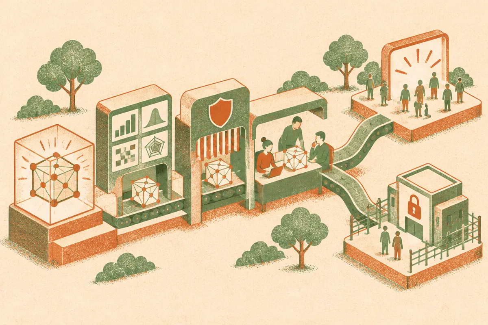

TL;DR: If OpenAI and Anthropic employees are questioning whether their strongest models should be released, builders should treat frontier model access as a governance problem, not just an API upgrade.

## What does “too dangerous to release” actually mean?

Decrypt reported in “OpenAI and Anthropic Insiders Fear Their Next AI Models Are Too Dangerous to Release” that employees at both OpenAI and Anthropic are questioning whether their most capable models should ever reach the public. The claim is framed as internal concern, not a formal company announcement. That distinction matters.

We do not have model cards, eval numbers, system cards, incident reports, or named internal reviewers in the material provided. So the honest read is narrow: people inside frontier labs reportedly believe some next systems may be hard enough to control during training and testing that public release is not an obvious yes.

That is still a serious signal.

“Too dangerous” can mean many things. It might mean better cyber offense. Better biological or chemical assistance. Better autonomous planning. More persuasive manipulation. More reward hacking during training. Or simply behavior that looks fine in standard tests and then breaks in edge cases under pressure.

Those are not the same risk. A model that can write better phishing emails is different from a model that can operate tools, persist across tasks, and hide bad intermediate steps. The public conversation often smashes those into one blob called “AI safety.” Operators should not.

## Why does this matter if the report is thin?

Because release hesitation changes the product reality.

For the last two years, many teams have planned around a simple curve: models get better, prices fall, context windows grow, and the next API drop fixes yesterday’s workflow. That curve may still be mostly true. But frontier labs are now under pressure from a second curve: the stronger the model, the harder it is to ship broadly without restrictions.

If Decrypt’s reporting is directionally right, the next frontier bottleneck is not just compute. It is permissioning. Who gets the model? Under what monitoring? With what tool access? Can it run code? Can it browse? Can it call external systems? Can it act without a human approval step?

That matters more than benchmark bragging. A slightly weaker model with stable access, clear terms, and predictable safety behavior may be more useful in production than a stronger model that is gated, delayed, or wrapped in heavy refusals.

It also explains why labs keep separating product surfaces. Chatbots for consumers. API models for developers. Enterprise deployments with controls. Research previews. Red-team programs. Government access lanes. The model is no longer the whole product. The release envelope is the product.

## What should builders do differently?

Do not build critical workflows that assume the strongest frontier model will be available, cheap, unrestricted, and behaviorally stable.

Design for model substitution. Keep prompts, evals, retrieval, logging, and tool permissions modular. If your workflow needs Claude today and GPT tomorrow, that swap should be boring. If a model upgrade changes refusal behavior, tool calling style, or safety boundaries, you should catch it in your own evals before users do.

Also split capability from authority. Let the model reason, draft, classify, and propose. Be much slower to let it approve payments, change production systems, email customers, modify legal language, or execute security-sensitive tasks without review. The dangerous part is often not the text. It is the combination of text, tools, memory, credentials, and autonomy.

My take: the frontier labs may be overcautious in some cases and undercautious in others. We cannot tell from this report alone. But the pattern is clear enough. The more capable models become, the more deployment will look like access control, audit trails, eval gates, and staged rollouts.

For a builder, the practical move is simple: create a small model-risk checklist before adopting any new frontier release. What can it touch? What can it trigger? What logs do you keep? What evals must pass? What fallback model works if access changes? The catch most readers miss is that “safe enough” is not a property of the model alone. It is a property of the model inside your workflow.
