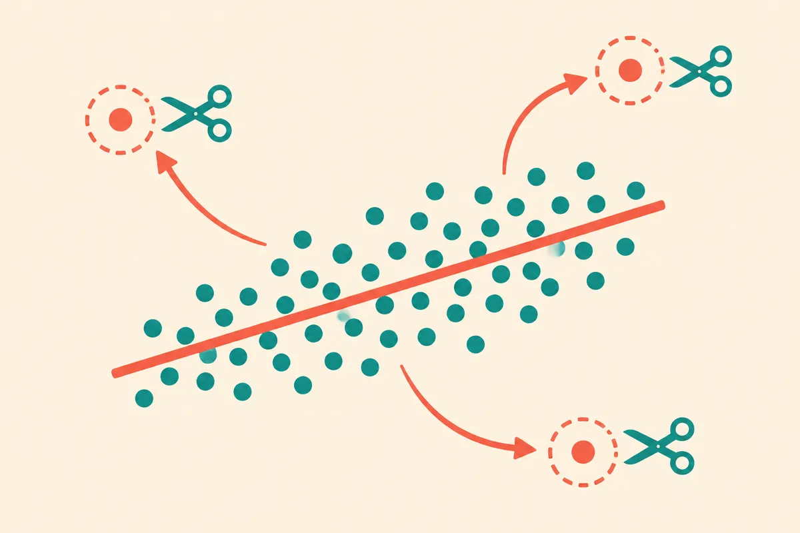

TL;DR: "Optimal Linear Regression Without a Variance" gives a black-box way to turn any good finite-variance regression method into one that still works when your noise has infinite variance, by pruning the worst residuals, with no need to know the noise scale or how heavy the tails are.

Most regression theory quietly assumes your noise has a finite variance. That assumption fails more often than people admit. Financial returns, network latencies, insurance claims, click data, anything with fat tails: these can have noise so heavy that the variance is literally infinite. The theoretical guarantees you learned in school do not apply there. A new paper on arXiv, "Optimal Linear Regression Without a Variance" (listed under both cs.AI and cs.LG), tackles exactly that gap, and the result is cleaner than I expected.

## What does "regression without a variance" actually mean?

Here is the setup in plain terms. You have the usual linear model: a target that is a linear function of your features plus noise. The standard story assumes that noise has a finite variance, which is what lets you bound how far your estimate strays from the truth.

This paper drops that. It only assumes the noise has a finite conditional α-moment for some unknown α between 1 and 2. When α is below 2, the variance can be infinite. Think of a distribution where occasional observations are so extreme that squaring them and averaging blows up. The noise still has a well-defined center (α above 1 guarantees a mean exists), but the spread is not controllable in the usual sense.

The covariates get a similarly weak assumption: they only need finite moments up to some order, with the paper's cleanest results using a finite fourth moment. So both the inputs and the noise are allowed to be messy.

Why care? Because real data does this to you constantly. A handful of catastrophic outliers can dominate a least-squares fit. The standard fix is to reach for robust methods, tune some threshold, cross-validate, and hope. This paper offers something more principled.

## How does the residual-pruning reduction work?

The core move is a reduction. Instead of inventing a new estimator from scratch, the authors show how to wrap any existing finite-variance regression procedure and make it survive the heavy-tailed regime. That is the part I find genuinely useful. You do not throw away the tools that already work. You convert them.

The mechanism is empirical residual pruning. You run your base procedure, look at the residuals, and prune the ones that look pathological, then refit. The key property the authors stress is that this pruning is agnostic: it does not need to know α (how heavy the tails are), it does not need the noise scale ν, it does not need the covariance structure, and it does not need the design moment. That matters because in practice you almost never know those things. If a method required you to specify the tail index, it would be a theory paper you could not use. This one does not.

The guarantee: if your base subroutine attains the sub-Gaussian rate in the finite-variance case, then once you have enough samples, the wrapped version achieves an error bound that scales with the number of samples n, dimension d, and the moment bound ν, with the rate exponent (α−1)/α. When α approaches 2 (closer to finite variance) that exponent approaches 1/2, the familiar rate. When α approaches 1 (noise so heavy it barely has a mean) the rate degrades toward zero progress, which is exactly what it should do. The math is honest about the price of heavy tails rather than hiding it.

And the authors prove a matching minimax lower bound under the same conditions. That is the part that elevates this from "a method that works" to "a method you cannot beat." No procedure can do asymptotically better under these assumptions. The word "optimal" in the title is earned, not decorative.

## Is this practical or just a theory flex?

Both, and the practical side is the reason I am writing about it.

The reduction is computationally efficient whenever the base subroutine is. So you are not paying a huge compute tax for the robustness. You are mostly adding a pruning pass. The authors also extend the idea beyond regression: they give a distribution-free prediction guarantee under a bounded raw α-moment on the response, and an analogous α-agnostic reduction for plain mean estimation. Mean estimation under heavy tails is a surprisingly deep problem (the ordinary sample mean is terrible there), so getting an agnostic reduction for it is a nice bonus.

Now the honest caveats. This is a theory paper. The abstract describes guarantees and a reduction, not a benchmark suite or an open-source library. I have not seen reported experiments on real datasets, so treat the practical speedups and accuracy gains as implied by the theory rather than measured. The "enough samples" threshold is defined suitably but it is a threshold, meaning small-sample regimes may not enjoy these bounds. And the fourth-moment condition on covariates, while weak, is still an assumption; data with heavy-tailed features beyond that may need more care.

## What should a builder take from this?

If you fit linear models on data with known outlier problems, this is a design pattern worth stealing even before a library shows up. The pattern is: run your trusted estimator, compute residuals, prune the extreme ones without a hand-tuned threshold tied to assumed variance, refit. People already do ad hoc versions of this. The contribution here is a principled, tuning-free version with a proof that it is optimal.

The practitioner's take: do not wait for a package. The residual-pruning idea is simple enough to prototype in an afternoon against your current regression pipeline, and the thing to test is whether removing the "set a threshold" step actually matches or beats your cross-validated robust method on held-out error. The catch most readers will miss is that the guarantee lives in the large-sample regime, so if your real problem is twenty rows with three outliers, this theory does not rescue you: it rescues the case where you have plenty of data but the tails never settle down. Match the method to that situation and it is a clean upgrade. Reach for it in the small-data corner and you are using a telescope to read a book.
