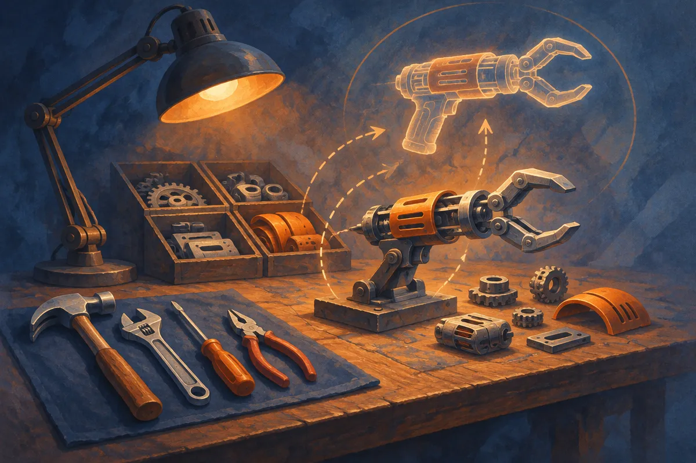

TL;DR: Two 2026 papers push search agents in opposite but complementary directions, ToolSmith grows the tool library automatically while CO-GRAFT shows that most reinforcement learning gains come from answer extraction and retrieval behavior rather than the clever query writing everyone optimizes, and together they tell you to stop over-indexing on prompts and start measuring where your agent actually improves.

Search agents are the quiet workhorse of applied AI right now. Not the chat demos. The things that reason across turns, call a search tool, read what comes back, maybe look at an image, and answer a question the base model could not. Everyone building them hits the same two walls: the tools are a pain to build and maintain, and nobody can tell which part of the system is responsible when the agent gets better or worse.

This pillar maps where that stands. I will anchor it on two primary sources I can name precisely, plus a third that sits adjacent and is worth understanding for contrast.

## What problem are search agents actually solving?

A multimodal search agent answers questions that live outside the model's weights. Current events, obscure facts, things that require looking at a chart or a photo and then going to find corroborating evidence. The pattern is now fairly settled: the model reasons, decides whether to search or answer, writes a query, reads retrieved content, and extracts a final answer. Repeat across turns until done.

That loop depends on a tool library. Search tools, visual tools, maybe a zoom or crop tool for images. The library is almost always hand-crafted. And that is the first wall.

The ToolSmith paper, "ToolSmith: An Automatic Tool-Generation Framework for Multimodal Search Agents" (arXiv, project page at https://threesr.github.io/toolsmith/), states the problem bluntly: the hand-crafted library "is laborious to create and maintain, and frozen when new query types, evidence formats, and failure modes are encountered in the wild." That matches what I see in production. You build a crop tool and a reverse-image tool and a date-parser, and three weeks later a query type shows up that none of them handle, and your agent silently fails.

The second wall is attribution. Reinforcement learning makes these agents better, sometimes dramatically. The CO-GRAFT paper reports that RL "improves large language model search agents by up to 32 exact-match (EM) points over their pre-RL initializations." But a 32-point gain tells you nothing about *why*. Which capability improved? The reasoning? The query writing? The answer extraction? Until recently the honest answer was: we have no idea, we just see the number go up.

So the field has two open problems. Tools that go stale, and gains you cannot explain. The two papers I am anchoring on attack one each.

## How does ToolSmith grow a tool library automatically?

ToolSmith's move is to treat tools the way a human handyman treats them. When you lack the right tool, you fashion a new one from familiar parts and reuse it. The paper frames it exactly that way: "Human practitioners, by contrast, cope with insufficient tools by fashioning new ones from familiar parts and reusing them across tasks."

Mechanically, ToolSmith starts from a "lean base tool library" and grows modules on top of it, reusing what it builds across tasks. So instead of a frozen set of ten hand-written tools, you get a small base set plus an expanding library the system assembles itself as it meets new query types.

The evaluation is where I take it seriously. The team tested on three in-domain multimodal search benchmarks and ten out-of-domain benchmarks under a VLM-as-a-Judge protocol. The out-of-domain count matters more than the in-domain count, because the whole pitch is handling evidence formats and failure modes you did not anticipate. They report that ToolSmith "consistently improves over the base library across deployed agents of varying scales, with larger backbones reaping greater gains."

That last clause is the interesting part and the one to hold lightly. Larger backbones reaping greater gains is a scalability story: the approach gets more useful as models get stronger, presumably because a stronger model is better at writing and wiring together a usable new tool. It is also the kind of claim that can mask a weaker result on small models. If your deployment runs a small backbone, do not assume you inherit the headline gains.

This connects to something I have written about before. A tool library is only as good as its awareness of its own failures. I argued in [tool retrieval should know when the tool is broken](/blog/2026-10-12-tool-retrieval-should-know-when-the-tool-is-broken/) that retrieval over tools has to account for the tool being wrong, not just absent. ToolSmith is the generative counterpart: when the right tool is absent, make one. The missing piece across both is the feedback loop, knowing a generated tool is bad and not reusing it.

## Where do reinforcement learning gains actually come from?

This is the better paper for changing how you work, and it deserves its full title: "CO-GRAFT: Attributing Reinforcement Learning Gains in Search Agents via Role-Level Policy Grafting" (arXiv). The method is clever in a way that is also practical, so it is worth understanding.

CO-GRAFT takes an RL-trained agent and its pre-RL version and has them jointly generate a single trajectory, under closed-loop execution with live retrieval. The key trick: each policy controls a mutually exclusive subset of four functional roles. The four roles are intermediate reasoning, the search-or-answer decision, search query generation, and final answer extraction.

Because there are four roles and each can be assigned to either the trained or untrained policy, there are 2^4 = 16 role assignments. You evaluate all sixteen without retraining or touching weights. That setup defines a cooperative game, and the Shapley values from that game decompose the total RL gain across the four roles. Möbius interaction terms then separate standalone improvements from cases where two roles only help when coupled.

That is a genuinely principled way to answer "what did RL actually buy me." Not an ablation that breaks the system, not a vibes read of the logs. A decomposition with interaction terms.

The headline finding is the one I want every builder to sit with: query generation never exceeds 15% of the total gain. Read that again. The part of the pipeline most people obsess over, writing better search queries, is the smallest contributor to RL improvement across the settings they tested.

## Which capability should a search agent builder optimize first?

CO-GRAFT's answer reorders your priorities. According to the paper, the gains "are governed by pre-RL answer validity, search retention, model scale, and fixed task-level search budgets." The credit shifts "from reasoning toward answer extraction in larger or well-formatted answer response checkpoints while smaller base models rely on reasoning-decision coupling."

Unpack that for practice. If you are running a larger or well-formatted model, the RL win mostly lands in answer extraction, pulling the right answer out of retrieved content cleanly. If you are running a smaller base model, the win comes from the coupling of reasoning and the search-or-answer decision, the model thinking and then deciding whether it has enough to answer.

The evaluation breadth is what gives this weight. They applied CO-GRAFT to Search-R1 agents across Qwen2.5 and Llama-3.2 models, spanning two sizes, base and instruction-tuned initializations, GRPO and PPO optimizers, and the NQ and HotpotQA datasets. That is a wide grid. A finding that holds across two model families, two sizes, two tuning states, two optimizers, and two datasets is a finding I will adjust my priors on.

So the concrete reordering: stop treating query engineering as the main lever. For a strong model, invest in answer extraction, the formatting and parsing of final answers from retrieved text. For a weak model, invest in the reasoning-to-decision handoff, helping it judge when it has enough. This lines up with a theme I keep coming back to, that the decision of when to stop and act is undervalued. I made a version of this argument in [the evaluate-first turn in AI research agents](/blog/2026-09-01-the-evaluate-first-turn-in-ai-research-agents/), and the small-model finding here echoes [a small model that steers a bigger one's reasoning](/blog/2026-09-23-a-small-model-that-steers-a-bigger-ones-reasoning/), where the reasoning-decision interface is exactly where leverage concentrates.

## Where do the two papers agree, and where do they pull apart?

They agree on the diagnosis, which is encouraging because they were written independently. Both treat the search agent as a system of distinct functional parts, not one monolithic model. ToolSmith names the tooling as a separable, improvable component. CO-GRAFT names reasoning, decision, query, and extraction as separable roles with separately attributable gains. The shared worldview is modular: the agent is a pipeline, and you improve it by finding which module is the bottleneck.

They pull apart on what they think the bottleneck is. ToolSmith bets on tools, the external capabilities the agent can invoke. CO-GRAFT bets, implicitly, on the internal roles, and finds that query generation (which is adjacent to tool use) is the least important of the four. That is not a contradiction, because tool generation and query generation are different things. A better crop tool is not a better search query. But it is a tension worth naming: if query generation contributes under 15% of RL gains, a reader could reasonably ask whether the tooling layer that ToolSmith expands is itself on the low-leverage side of the system.

My read is that they are measuring different axes. CO-GRAFT measured RL gains on a fixed tool set with text search. ToolSmith measured what happens when you change the tool set itself, especially for multimodal evidence where the right visual tool genuinely unblocks a query that no amount of reasoning solves. Vision tools are a known hard spot. I have written about agents needing to look before they search in [video deep research agents need to look before they search](/blog/2026-08-05-video-deep-research-agents-need-to-look-before-they-search/) and about forcing a model to zoom in on a chart in [teaching a model to zoom in on a chart before it judges a claim](/blog/2026-07-20-teaching-a-model-to-zoom-in-on-a-chart-before-it-judges-a-claim/). For multimodal work, the tool matters more than CO-GRAFT's text-search numbers would suggest.

## Where does the EEG-to-fMRI work fit, and why mention it?

The third source I was handed is "Learning Neurovascular Codes for EEG-to-fMRI Synthesis" (arXiv), and I am including it honestly: it is not a search agent paper. It is a cross-modal brain modeling paper that trains EEG encoders to predict fMRI signals, freezes them, projects their features into a shared "neurovascular code," and uses a stochastic interpolant to generate fMRI from that code. It reports improving average Pearson correlation over the strongest encoder baselines by 19.1% within-subject and 19.8% held-out-subject, evaluated across eight public simultaneous EEG-fMRI datasets with 61,646 volume-level pairs.

So why is it in the same pillar? One structural reason, and I will flag that it is my framing, not a claim any of these papers make. The neurovascular-code method freezes specialized encoders and fuses them into a shared representation, which is the same architectural instinct ToolSmith follows with tools and CO-GRAFT assumes about roles: build specialized components, keep them frozen or modular, and compose. The pattern of "freeze the specialists, compose their outputs" is showing up across very different subfields. That is worth noticing even when the domains do not touch. I would not stretch it further than that, and nobody should cite the brain paper as evidence about search agents.

## What should a practitioner do right now, and what to watch?

If you build or operate search agents, the immediate moves are clear. First, instrument your pipeline by role before you optimize anything. CO-GRAFT gives you the conceptual carve-up, reasoning, decision, query, extraction, even if you do not run the full Shapley machinery. Just knowing which role your errors cluster in is most of the value.

Second, match your investment to your model size. Strong backbone, work on answer extraction and output formatting. Small backbone, work on the reasoning-to-decision handoff. Do not default to query engineering, the evidence across Qwen2.5 and Llama-3.2 says it is the smallest lever.

Third, if you run multimodal and your failures are "the agent never looked at the image properly" or "no tool existed for this evidence format," that is where ToolSmith-style automatic tool generation earns its keep. But build the feedback loop ToolSmith's abstract does not dwell on: a generated tool needs a way to be judged bad and retired, or your auto-grown library rots the same way the hand-crafted one did. Red-teaming the tool layer matters too, I argued for mapping agent attack surface rather than tossing scary prompts in [agent red teams need maps, not just scary prompts](/blog/2026-10-12-agent-red-teams-need-maps-not-just-scary-prompts/), and an auto-generated tool is a new attack surface.

The catch most readers will miss: both papers measure on benchmarks, and benchmark gains are not the same as a usable agent. CO-GRAFT's role attribution was computed on NQ and HotpotQA, clean QA datasets. ToolSmith's gains ran under a VLM-as-a-Judge protocol, which is itself a model making calls. Your production distribution is messier than both. Treat these findings as strong priors about where leverage lives, not as settled constants. The 15% ceiling on query-generation gains is the single most actionable number here, and even that I would re-measure on my own traffic before betting a roadmap on it.

What to watch next: whether anyone fuses the two. An auto-growing tool library (ToolSmith) with role-level attribution (CO-GRAFT) telling you whether the new tools actually moved the roles that matter. That closed loop, generate tools, measure their contribution per role, retire the dead weight, is the obvious next paper. When it shows up, it is the one that turns these two diagnoses into a maintenance discipline.
